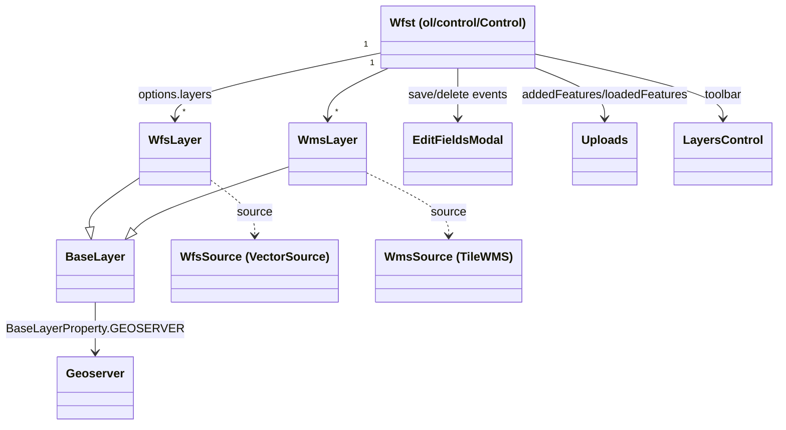
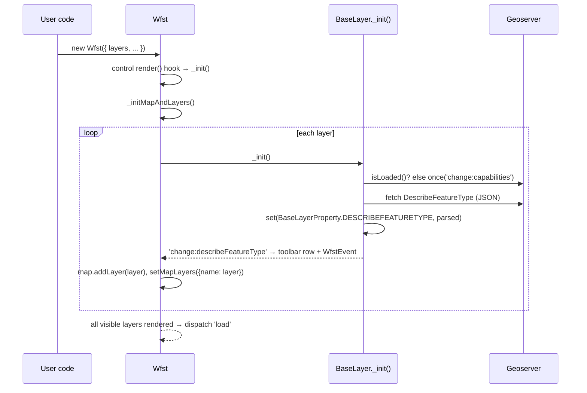

# ARCHITECTURE.md

How `ol-wfst` fits together. For conventions, tooling and how to work on the code, see [AGENTS.md](AGENTS.md).

## 1. Entry points & build pipeline

There are two bundles, two entry points, and a shared set of external dependencies:

| Bundle     | Entry              | Output                                                                | Consumers                                                                |
| ---------- | ------------------ | --------------------------------------------------------------------- | ------------------------------------------------------------------------ |
| UMD (dist) | `src/index-umd.ts` | `dist/ol-wfst.js`, `dist/ol-wfst.min.js`, `dist/css/*.css`            | `<script>` users; the demo (`examples/basic.html`). Global name: `Wfst`. |
| ESM (lib)  | `src/ol-wfst.ts`   | `lib/ol-wfst.js` + `.d.ts`, `lib/style/css/*.css`, `lib/style/scss/*` | Bundlers (Vite/webpack/rollup); `package.json#module`/`types`.           |

- `src/index-umd.ts` only does `Object.assign(Wfst, { WfsLayer, WmsLayer, Geoserver })` so UMD users get everything from the single global.
- Externals are identical in spirit: `ol/*` (a few exceptions are inlined, e.g. `ol/TileState`, so CSS-less UMD works), `modal-vanilla` (global `Modal`), `tiny-popup-menu` (global `TinyPopupMenu`) and `events` (global `EventEmitter`). In the lib build _everything_ except `src/jsx-runtime` is external, so consumers resolve their own OL copy.
- CSS: both rollup configs compile `src/assets/scss/ol-wfst.scss` and `-ol-wfst.bootstrap5.scss` through postcss (`postcss-preset-env` targets old browsers). Dist emits min + non-min; lib emits `lib/style/css/ol-gisify.css` (legacy name, still referenced by `package.json#style`) and copies the raw SCSS to `lib/style/scss/`.
- `npm run watch` runs the dist config in dev mode: no minification, CSS injected in JS, serve + livereload on `localhost:3000` with `examples/`.

## 2. Composition

- Layers are `Mixin(BaseLayer, VectorLayer)` (WFS) or `Mixin(BaseLayer, TileLayer)` (WMS) via `ts-mixer` — `BaseLayer` extends `ol/layer/Base` and carries the GeoServer-specific logic (DescribeFeatureType, transactions, lockFeature).
- Everything layer-specific is stored as OL Object properties keyed by `BaseLayerProperty` (`name`, `label`, `geoserver`, `describeFeatureType`, `isVisible`), so it survives the mixin and is observable via `change:*`.
- The `Geoserver` instance is shared between layers (one client per server, many layers). It is an `ol/Object`: `setUrl/setHeaders/setCredentials` fire `change:*`, and `getAndUpdateCapabilities()` fires `change:capabilities` when WFS GetCapabilities is parsed.

## 3. Data flows

### 3.1 Initialization

The parsed DFT (`_parsed`: namespace, properties, geomType, geomField) drives the edit-fields form, the CQL field list, geometry-type checks when drawing, and the WMS→WFS geometry re-query.

### 3.2 Edit cycle

1. `activateEditMode(true)` + a selection interaction (single / box / freehand, `SelectionMode` in `state.ts`) picks features; each is locked optionally via `BaseLayer.maybeLockFeature()`.
2. Selected features are moved to the singleton edit layer (`modules/editLayer.ts`, `zIndex: 100`) and originals are snapshotted in `Wfst._editFeaturesOriginal`.
3. `EditOverlay` anchors on the selection: `editFields` → `EditFieldsModal.show(features)`; `editGeom` → Modify/Snap + `ExtendLineOverlay` buttons on line endpoints.
4. `EditFieldsModal` renders a form (single) or a table (multi, "table mode") and dispatches `save` / `delete`; `Wfst` maps them to `Geoserver.transact(Update|Delete, ...)` through `BaseLayer.transactFeatures()`.
5. `EditControlChanges` (Apply/Cancel/Delete bar) commits everything at once (`apply`), restores originals (`cancel`) or deletes (`delete`).

### 3.3 Draw & upload

- `activateDrawMode(layer)` enables `ol/interaction/Draw` against the active insert layer; `drawend` features go through `beforeTransactFeature` and then `insertFeatures()`.
- `Uploads` reads GeoJSON/KML/WFS files (`processUpload` hook allows custom parsers), fixes/validates geometries, then emits `loadedFeatures` (features added to the edit layer for review) and `addedFeatures` (direct insert into the target layer).

### 3.4 Query / Feature Info

`activateQueryMode(true)` installs a click interaction: WMS layers answer via GetFeatureInfo (`WmsLayer._getFeaturesByClickEvent`), WFS layers via a precise GetFeature request (`_getFeaturesInGeometry`/`_requestFeatures` — WMS tiles are too coarse for exact geometry). The result opens in `QueryOverlay`; matched features are highlighted on a dedicated `_highlightLayer`.

### 3.5 CQL filters

- Opt-in via `Options.showCqlFilters`; `LayersControl` shows a "More" menu (`tiny-popup-menu`) per layer with a filter entry.
- `FilterCqlModal` builds the filter with the pure helpers in `modules/cql.ts` (`parseCql`/`buildCql`, field types and operators from the DescribeFeatureType).
- Applying calls `WfsLayer.setCqlFilter()` / `WmsLayer.setCqlFilter()`, which forward to `WfsSource`/`WmsSource` and refresh the layer; both dispatch `cqlFilterChanged`.

## 4. Global state

`modules/state.ts` is a plain module singleton (no class, no instance): `map`, `mode` (`Modes.Edit | Draw | Query`), `selectionMode`, `layerToInsertElements`, `editedFeatures: Set<string>` and the `mapLayers` registry (`IWfstLayersList`).

Why a module: every UI piece (`LayersControl`, `styleFunction`, `BaseLayer`, overlays) needs the current mode/map/layer without threading instances through constructors or creating circular imports. There is exactly one `Wfst` per map, so module scope == instance scope.

Related singletons: `modules/editLayer.ts` (the shared edit layer) and `modules/i18n` (the mutable `I18N` object).

## 5. Events

All emitters extend `ol/Observable`; public event types are narrowed with `declare on/once/un` signatures (`OnSignature & CombinedOnSignature`).

| Emitter                                          | Events                                                                                                                                                      |
| ------------------------------------------------ | ----------------------------------------------------------------------------------------------------------------------------------------------------------- |
| `Geoserver`                                      | `change:capabilities`, `change:parsedCapabilities`, `change:url`, `change:headers`, `change:credentials`, `change:advanced` (all `GeoserverProperty` keys). |
| `BaseLayer` / `WfsLayer` / `WmsLayer`            | `layerRendered`, `change:describeFeatureType`, `change:isVisible`, `cqlFilterChanged`.                                                                      |
| `Wfst`                                           | `load`, `describeFeatureType` (custom `WfstEvent` with `layer` + `data`), `modifystart`, `modifyend`, `drawstart`, `drawend`, plus OL object events.        |
| `Uploads`                                        | `addedFeatures`, `loadedFeatures`.                                                                                                                          |
| `EditFieldsModal`                                | `save`, `delete`.                                                                                                                                           |
| `EditControlChanges`                             | `apply`, `cancel`, `delete`.                                                                                                                                |
| `EditOverlay` / `QueryOverlay` / `LayersControl` | `editFields`, `editGeom`; `close`; `changeLayer`, `queryMode`, `drawMode`, `selectModeSingle/Box/Freehand`, `changeGeom`, `filterChanged`.                  |

DOM events from JSX (`onClick` → `click`) are used for local wiring inside a component only; cross-component communication goes through OL events or `state.ts`.

## 6. JSX runtime

`src/jsx-runtime.ts` is a ~70-line runtime used by `tsconfig.json` (`"jsx": "react-jsx"`, `"jsxImportSource": "src"`) — React is never involved.

- Function tags receive `(props, children)` (this is how `EditOverlay`, overlays and `render()` compositions work); string tags become `document.createElement`.
- Supported props: `className`, `htmlFor`, `on*` (→ `addEventListener`), anything else via `setAttribute`.
- `<>...</>` fragments are **not** supported (the runtime's `Fragment(type, children)` doesn't match the `{ children }` object the compiler emits). Use a wrapper element.
- SVG imports resolve to **functions returning the DOM element** (`rollup-plugin-svg-import`), never strings for `src=`. See AGENTS.md #Icons.

## 7. i18n

- `modules/i18n/index.ts` holds the mutable `I18N` object (default `en`), `setLang(lang, custom)` and `I18N_(key, ...args)` (replaces `{}` placeholders, falls back with a console warning).
- `Wfst`'s constructor calls `setLang(options.language, options.i18n)` — custom dictionaries are shallow-merged over the built-in one.
- Adding a string: declare it in `I18n.labels` (`src/@types.ts`) and provide it in `es.ts`, `en.ts` and `zh.ts`.

## 8. Extending the library

| Task                 | Where                                                                                                                                       |
| -------------------- | ------------------------------------------------------------------------------------------------------------------------------------------- |
| New toolbar button   | `LayersControl.tsx` (`render()` + a helper from the state-button exports); keep `ol-wfst--` class naming and an SVG from `assets/images/`.  |
| New option           | `interface Options` in `ol-wfst.ts` + default in `defaults.ts` + JSDoc (it feeds the README).                                               |
| New layer capability | `BaseLayer` (shared logic) or the concrete layer; expose it through `declare on/once` overloads.                                            |
| New UI string        | `@types.ts` `I18n.labels` + the three i18n files.                                                                                           |
| New edit workflow    | Reuse the edit-layer snapshot pattern in `ol-wfst.ts` (`_editFeaturesOriginal`, `EditControlChanges`) instead of creating a parallel state. |
